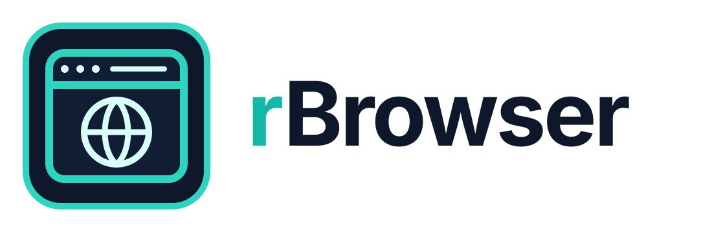

# rBrowser

<picture>
  <source media="(prefers-color-scheme: dark)" srcset="assets/rBrowser-logo-dark.svg">
  
</picture>

A development browser that shows **every breakpoint of a site at once**. One window holds a
freely configurable grid of views, and navigation, scrolling, clicks, typing, keys and hover run
in sync across all of them, replayed as real input events. A layout bug at one breakpoint no
longer goes unnoticed while you look at another.

- **Every breakpoint in one window**: a grid of columns, rows and spans, zoom per view, layout
  presets and a focus layout. Device presets set the viewport, pixel ratio, user agent, touch
  and safe areas, and a breakpoint analyser proposes the views from the site's own media queries.
- **Synchronised**: navigation, scrolling, clicks, form input, keyboard and hover follow the view
  you work in; a view that drifts out of step is marked and brought back.
- **Shared with the team**: the grid, the devices and the settings live in the project, in
  `.rbrowser/config.json`, checked in with the code, so everyone opens the same setup.
- **Three engines**: Chromium in the grid, plus your installed Firefox and Playwright's WebKit
  as synchronised windows of their own.
- **Built for AI and automation**: a built-in MCP server whose tools address one view or all of
  them, and a token-protected endpoint for Playwright's `connectOverCDP`. Flows, a recorder that
  writes Playwright tests, and a page API for your own scripts.
- **The tools of the job**: DevTools for every view, overlays, rulers and guides, a colour picker,
  network mocks, screenshots of every view at once with an editor, video, visual regression, and
  checks for accessibility, SEO and PWA, all in one list of findings.
- **WSL aware**: opens projects inside a WSL distribution, reloads when you save, and takes
  commands from tools and AI agents running in WSL.
- **Plugins**: most features beyond the core are sandboxed WebAssembly plugins. The SDK, with
  templates for your own, is in [`sdk/`](sdk/README.md).
- A portable mode that keeps every setting beside the program.

## Status

**Beta.** rBrowser is young: expect rough edges and changes between releases. What each release
changed is in [CHANGELOG.md](CHANGELOG.md).

rBrowser runs on **Windows 10 and 11 (x64)** and on **macOS 13 or later** (Apple Silicon and
Intel). Linux follows later.

## Download

Every release is on [GitHub Releases](https://github.com/degoya/rBrowser/releases) and lists its
files with their SHA-256 in `SHA256SUMS`.

**Windows.** No installer and no administrator rights are needed: unpack the whole
`rbrowser-<version>-windows-x64.zip` into a folder of your own and start `rbrowser.exe`. Do not
start it from inside the zip or from a WSL share: the browser sandbox refuses both. The program is
not code-signed yet, so Windows SmartScreen may warn on the first start; choose *More info* and
*Run anyway*. Node.js is not needed: the package carries its own runtime.

**macOS.** Download `rbrowser-<version>-macos-aarch64.dmg` for Apple Silicon or
`rbrowser-<version>-macos-x86_64.dmg` for an Intel Mac (each also as a zip), open it and drag
rBrowser into Applications. The app is signed ad hoc, not notarised, so macOS refuses its first
start: open *System Settings > Privacy & Security* and choose *Open Anyway* (on macOS 14 and
earlier, a right-click on the app and *Open* does the same), or remove the quarantine flag once:

```bash
xattr -dr com.apple.quarantine /Applications/rBrowser.app
```

The macOS app does not carry WebKit views, flows and Lighthouse yet, and it updates by download:
it shows a new release and opens its page.

Firefox (version 140 or newer) is optional and only needed for Firefox views.

### Package managers

Scoop, winget and Homebrew carry full releases only; a beta (a pre-release on GitHub Releases)
is downloaded from there.

```powershell
scoop bucket add rbrowser https://github.com/degoya/scoop-rbrowser
scoop install rbrowser               # Windows (Scoop)
winget install degoya.rBrowser       # Windows (winget)
```

```bash
brew install --cask degoya/rbrowser/rbrowser   # macOS (Homebrew)
```

winget lists rBrowser once Microsoft has reviewed its first submission. An installation through a
package manager is updated by it (`scoop update`, `winget upgrade`, `brew upgrade rbrowser`).

## Documentation

The handbook is the [wiki](https://github.com/degoya/rBrowser/wiki):

- **Getting started**: [Installation](https://github.com/degoya/rBrowser/wiki/installation) ·
  [WSL setup](https://github.com/degoya/rBrowser/wiki/wsl-setup) ·
  [Set up MCP](https://github.com/degoya/rBrowser/wiki/mcp-setup)
- **Using rBrowser**: [Grid and views](https://github.com/degoya/rBrowser/wiki/grid-and-views) ·
  [Sync](https://github.com/degoya/rBrowser/wiki/sync) ·
  [Emulation and devices](https://github.com/degoya/rBrowser/wiki/emulation) ·
  [Engines](https://github.com/degoya/rBrowser/wiki/engines) ·
  [DevTools](https://github.com/degoya/rBrowser/wiki/devtools) ·
  [Screenshots](https://github.com/degoya/rBrowser/wiki/screenshots) ·
  [Checks and findings](https://github.com/degoya/rBrowser/wiki/checks)
- **Automation**: [Playwright](https://github.com/degoya/rBrowser/wiki/playwright) ·
  [Flows](https://github.com/degoya/rBrowser/wiki/playwright-flows) ·
  [MCP server](https://github.com/degoya/rBrowser/wiki/mcp) ·
  [MCP tools](https://github.com/degoya/rBrowser/wiki/mcp-tools) ·
  [Command line](https://github.com/degoya/rBrowser/wiki/cli)
- **Reference**: [Configuration](https://github.com/degoya/rBrowser/wiki/configuration) ·
  [Settings](https://github.com/degoya/rBrowser/wiki/settings) ·
  [Keyboard shortcuts](https://github.com/degoya/rBrowser/wiki/shortcuts)
- **Plugins**: [Plugins](https://github.com/degoya/rBrowser/wiki/plugins) ·
  [Plugin development](https://github.com/degoya/rBrowser/wiki/plugin-development) ·
  [`sdk/README.md`](sdk/README.md)
- **Help**: [FAQ and troubleshooting](https://github.com/degoya/rBrowser/wiki/faq)

A Playwright example that connects to the running app is in
[`examples/playwright/`](examples/playwright/connect.ts).

## Building from source

rBrowser is written in Rust on the Chromium Embedded Framework, with a Vue shell and a TypeScript
sidecar. The toolchain is pinned (`rust-toolchain.toml`, `.nvmrc`) and the Windows build is
cross-compiled from WSL2 with cargo-xwin; the handbook's
[Building](https://github.com/degoya/rBrowser/wiki/building) page has the steps.

## Contributing

Bug reports and ideas are welcome as [issues](https://github.com/degoya/rBrowser/issues). This
repository is an export of the development repository, refreshed at every release: a pull request
is a proposal that is applied by hand, with credit. Please report a vulnerability privately
through GitHub's security advisories, not as an issue.

## Licence

rBrowser is developed by Alexander Herling / DEGOYA.digital and licensed under the GNU General
Public License v3.0 or later, see [LICENSE](LICENSE). The plugin SDK (its templates, the WIT
contract and the CI workflow, [`sdk/LICENSE`](sdk/LICENSE)) and the panel runtime
`plugins/web-common/panel-ui` ([its LICENSE](plugins/web-common/panel-ui/LICENSE)) are MIT, so
plugins can use any licence.
